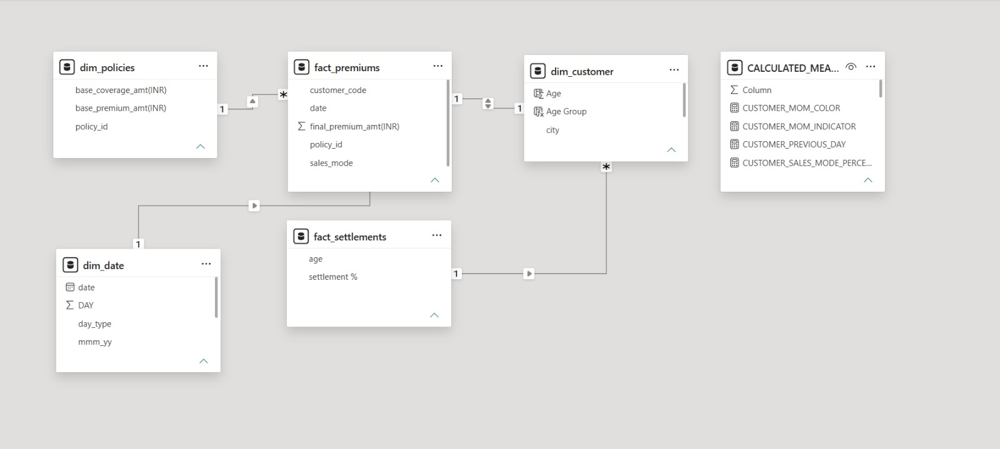

# 🛡️ Shield Insurance – Power BI Business Intelligence Dashboard

An interactive **insurance business intelligence solution developed using Microsoft Power BI** to examine premium performance, customer demographics, sales distribution channels, policy preferences and expected settlement patterns.

The project organizes insurance-related information into an interactive reporting environment, enabling users to explore business performance through dimensional data modelling, Power Query transformations and DAX-driven calculations.

---

# 🧩 Problem Statement

Insurance businesses need to monitor multiple dimensions of their operations, including customer distribution, policy performance, premium revenue and settlement-related indicators.

When these business dimensions are examined separately, it can become difficult to obtain a consolidated understanding of performance and compare results across customer segments and sales channels.

This project addresses the analytical need for a centralized reporting solution capable of exploring questions such as:

- How does premium revenue evolve over time?
- Which cities contribute to the overall revenue distribution?
- How are customers distributed across different sales modes?
- Which age segments contribute to customer volume and revenue?
- How do policy preferences vary across age groups?
- How does the available expected settlement percentage vary by customer age?

The objective is to bring these analytical perspectives together in an interactive Power BI reporting solution.

---

# 🎯 Project Objective

The primary objective is to develop an interactive insurance analytics dashboard that supports business performance monitoring and customer-segment analysis.

The dashboard is divided into three analytical perspectives:

- **Overall Business Performance:** Monitoring business KPIs, revenue trends and policy performance.
- **Sales Mode Analysis:** Understanding customer and revenue distribution across sales channels.
- **Age Group Performance:** Examining customer segmentation, revenue contribution, policy preferences and expected settlements.

The reporting solution is designed to make these business dimensions easier to explore through interactive visuals, filtering and page navigation.

---

# 📦 Dataset Overview

The project uses structured insurance data containing information required for customer, policy, premium and settlement analysis.

The Power BI model contains the following tables:

### Dimension Tables

- `dim_customer`
- `dim_date`
- `dim_policies`

### Fact Tables

- `fact_premiums`
- `fact_settlements`

### Supporting Table

- `CALCULATED_MEASURES`

The premium fact table supports customer, policy, date and sales-mode analysis. The settlement fact table supports age-based settlement percentage analysis.

⚠️ **Dataset Availability Notice**

The original dataset is associated with restricted project material and is not permitted to be publicly redistributed. Therefore, the raw dataset is intentionally excluded from this repository.

A separate technical document describes the available model structure and identified fields without exposing the original source records.

[View Dataset Overview](Documentation/Dataset_Overview.md)

---

# 🧹 Data Cleaning & Transformation

Data preparation and shaping were performed using **Power Query** within Microsoft Power BI.

The preparation workflow focused on organizing the available source tables for analytical reporting and ensuring that the model could support the intended dashboard views.

Key implementation areas include:

- Preparing the customer, date and policy dimension tables.
- Organizing premium and settlement information into fact tables.
- Preparing date attributes for chronological reporting.
- Using a numeric year-month sort field to maintain correct month ordering.
- Structuring the reporting model for customer, policy, sales-mode and time-based analysis.

DAX measures were subsequently developed to support KPI reporting and period-based comparisons.

---

# 🧠 Data Model – Star Schema Architecture

The Shield Insurance Power BI solution is built using a **Star Schema data modelling approach** to organize insurance-related information for analytical reporting.

The model separates measurable business information into fact tables and descriptive attributes into dimension tables. This structure provides an organized analytical foundation for examining customer, policy, premium and settlement-related performance.

### Fact Tables

- `fact_premiums`
- `fact_settlements`

### Dimension Tables

- `dim_customer`
- `dim_date`
- `dim_policies`

### Supporting Calculation Table

- `CALCULATED_MEASURES`

The fact tables contain the information used for business analysis, while the dimension tables provide descriptive context for slicing and examining the data.

The `CALCULATED_MEASURES` table provides a dedicated location for organizing DAX measures and is documented separately from the fact and dimension tables.

### Modelling Approach

The Star Schema approach supports:

- Structured analytical relationships between fact and dimension tables.
- Customer, policy and date-based analysis.
- Premium and revenue reporting.
- Sales-mode performance comparisons.
- Age-segment analysis.
- DAX-driven KPI calculations.

The model diagram will illustrate the implemented table relationships and overall schema organization.
# 📐 Data Model Diagram

The Power BI model diagram will be presented in this section.



*The diagram will be added after exporting an authorized screenshot of the model view.*

---

# 📊 Dashboard Preview

The Shield Insurance dashboard provides three primary analytical views.


*Dashboard preview image to be added after uploading an approved screenshot.*

### Dashboard Sections

1. Overall Business Performance
2. Sales Mode Analysis
3. Age Group Performance

---

# 📄 Full Dashboard Views

The complete report can be explored through the published Power BI dashboard.

[Open the Interactive Shield Insurance Dashboard](https://app.powerbi.com/view?r=eyJrIjoiYjAzNGViZTctMDVlNS00NWZjLWI0ODUtYTQ1MTBlNGQ4OTA4IiwidCI6ImM2ZTU0OWIzLTVmNDUtNDAzMi1hYWU5LWQ0MjQ0ZGM1YjJjNCJ9)

An exported PDF containing the individual dashboard pages can also be added to the repository when available and approved for sharing.

---

## 🎥 Project Walkthrough Video

Watch the complete walkthrough of the **Shield Insurance Power BI Analytics Dashboard**, covering the dashboard structure, analytical pages and interactive reporting experience.

[](https://youtu.be/KuFA-KzAISQ)

[Watch the Complete Project Demonstration](https://youtu.be/KuFA-KzAISQ)

---

# 🔍 Key Analytical Areas

The dashboard enables exploration of several business-performance dimensions:

- **Revenue Performance:** Examine premium and revenue trends over time.
- **Geographical Distribution:** Compare revenue contributions across cities.
- **Sales Channel Performance:** Evaluate customer and revenue distribution across sales modes.
- **Customer Segmentation:** Compare customer volume and revenue across age categories.
- **Policy Preferences:** Explore policy distribution across demographic segments.
- **Expected Settlements:** Compare settlement percentages across age groups.

These are the analytical capabilities provided by the report; specific numerical findings should be interpreted directly from the dashboard.

---

# ✅ Business Solution

The Shield Insurance dashboard brings different analytical perspectives into one reporting environment.

It enables users to:

- Monitor key business performance indicators.
- Examine revenue and premium trends.
- Compare sales channel contributions.
- Evaluate customer demographics.
- Explore age-based policy preferences.
- Review expected settlement percentages.
- Navigate between business performance sections through interactive reporting.

The solution provides a structured way to examine insurance business information without relying solely on isolated static reports.

---

# ⚙️ Data Pipeline & Architecture

The project follows a structured analytical workflow:

**1️⃣ Data Sources**

Restricted insurance source data containing customer, policy, premium and settlement information.

**2️⃣ Data Preparation**

Power Query used to prepare and shape the source tables for reporting.

**3️⃣ Data Modelling**

Fact and dimension tables organized to support analytical relationships and reporting context.

**4️⃣ Business Logic**

DAX measures developed for KPI calculations, revenue analysis and period-based comparisons.

**5️⃣ Visualization**

Interactive Power BI dashboards developed across overall performance, sales mode and age group perspectives.

**6️⃣ Publication**

The completed report published to Power BI Service for interactive viewing through an authorized report link.

---

# 🛠 Tools & Technologies Used

- **Microsoft Power BI** – Interactive dashboard development.
- **DAX (Data Analysis Expressions)** – KPI and analytical measure development.
- **Power Query** – Data preparation and transformation.
- **Dimensional Data Modelling** – Fact and dimension table organization.
- **Business Intelligence Design** – Reporting structure and data visualization.

---

# 🌐 Live Dashboard

Explore the published Shield Insurance report:

[**Open Live Power BI Dashboard**](https://app.powerbi.com/view?r=eyJrIjoiYjAzNGViZTctMDVlNS00NWZjLWI0ODUtYTQ1MTBlNGQ4OTA4IiwidCI6ImM2ZTU0OWIzLTVmNDUtNDAzMi1hYWU5LWQ0MjQ0ZGM1YjJjNCJ9)

---

# ⚠️ Analytical Scope & Limitations

- The original dataset is not included because redistribution is not permitted.
- The available settlement table contains age and settlement percentage information but no date or month field.
- Consequently, a true monthly settlement trend or month-over-month settlement calculation is not supported by the available settlement table.
- Dashboard access is subject to Power BI sharing permissions.
- Screenshots and additional report assets will only be added when authorized for public sharing.

---

# 📁 Repository Structure

```text
Shield-Insurance-BI-Analytics
│
├── images
│   ├── Shield_Insurance_Data_Model.png
│   └── Shield_Insurance_Dashboard_Preview.png
│
├── Documentation
│   └── Dataset_Overview.md
│
├── views
│   └── Shield_Insurance_Dashboard.pdf
│
└── README.md
```

*The image and PDF files shown above are planned repository assets. They should be added after the corresponding approved exports are available.*

---

# 📬 Contact

**Subhayan Kundu**

Aspiring Data Analyst | Business Intelligence | Data Analytics

Power BI | SQL | Advanced Excel | Python | Data Modelling

🔗 **LinkedIn:** https://www.linkedin.com/in/subhayan-kundu/

🌐 **Portfolio:** https://codebasics.io/portfolio/SUBHAYAN-KUNDU

💻 **GitHub:** https://github.com/Sub02

🎥 **Shield Insurance Project:** https://youtu.be/KuFA-KzAISQ

---

*Thank you for exploring the Shield Insurance Power BI project. This repository documents the analytical model, dashboard design and reporting workflow while respecting the restrictions on source-data distribution.*
